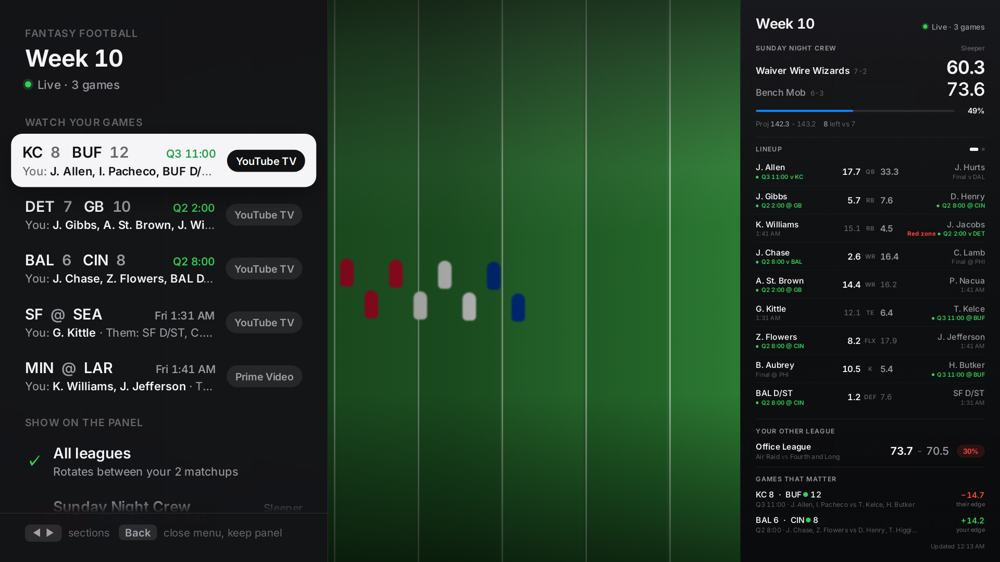

# Fantasy Panel for Google TV

Open **Fantasy Football** on your TV and a quiet side panel slides in: your
live fantasy score, win odds, a slot by slot lineup against your opponent, your
other leagues, and the NFL games that swing your week the most. Next to it, a
menu you drive with the remote:

- **Watch your games**: every live and upcoming game with your players in it.
  Pick one and it opens in **YouTube TV** (or **Prime Video** on Thursdays),
  with the panel still beside it.
- **Show on the panel**: all your leagues in rotation, or pin just one team.
- **Panel**: side panel, small score card, or hide.

Watching a tight game and want less on screen? **Fantasy Scores** toggles a small
score card in the corner without leaving what you are watching.

Works with **Sleeper** and **ESPN** leagues, any number of them, on any Google TV
or Android TV. Runs entirely in Docker on your computer: nothing to install
except Docker.


<table>
  <tr>
    <td></td>
    <td>
      <b>Your matchup</b>: live score, projected finish and a win probability that
      updates as the clock runs.<br><br>
      <b>Lineup</b>: every starter against his counterpart, with game clock,
      injury tags and projections for players yet to play.<br><br>
      <b>Other leagues</b>: one line each. The panel rotates through them, and jumps
      to a league the moment something happens there.<br><br>
      <b>Games that matter</b>: your projected points still to come in each NFL
      game, minus your opponents', across every league.<br><br>
      <b>Big plays</b>: a card pops in when one of your players (or one of theirs)
      scores big.
    </td>
  </tr>
</table>




## How it works

```
"Fantasy Football" tile                       "Fantasy Scores" tile
        |                                              |
        v                                              v
MenuActivity (remote-driven, Back closes)     toggles the score card
        |            \
        |             +--> Watch: YouTube TV / Prime Video search link for that game
        v
OverlayService: a non-focusable window docked to the side
        |
        v
WebView running web/ : Sleeper API + ESPN fantasy API + NFL scoreboard
                       refreshed every 20 s while games are live
```

- The panel never takes your remote. The menu has the remote only while it is
  open; Back, Home, or picking a game hands it straight back.
- "Watch" opens the streaming app's own search page for that game (for example
  "Houston Texans at Cleveland Browns" in YouTube TV), which lists the game first.
  You may see the app's "Who's watching?" screen first, as usual.
- Nothing runs while the panel is hidden, and it closes itself when the TV sleeps.
- No server, no account, no tracking. The TV talks straight to Sleeper and ESPN.

## Setup

You need Docker, and a TV with Developer options and Wireless debugging on
(Settings > System > About > tap "Android TV OS build" 7 times, then
Settings > System > Developer options > Wireless debugging).

```sh
make setup                               # creates config.local.json and the privacy hook
# edit config.local.json: Sleeper username, ESPN league + team id, TV address
make tv-pair PAIR=192.168.1.50:37123 CODE=123456   # from "Pair device with pairing code"
make tv-install                          # build, install, send your settings
```

Then open **Fantasy Football** from your apps row (or `make tv-open`). Up and
Down move, OK selects, Left and Right jump between sections, Back closes the menu
and leaves the panel up.

**Closing it:** **Hide panel** in the menu, or press **Home** on the remote. It also
closes itself when the TV goes to sleep. **Fantasy Scores** toggles the small card
on and off, and switches to it when the full panel is up.

### Config

```json
{
  "sleeper": { "username": "you", "leagueIds": [] },
  "espn": [{ "leagueId": 123456, "teamId": 1, "espn_s2": "", "swid": "" }],
  "panel": { "side": "right", "width": 0.26, "rotateSeconds": 15 },
  "watch": { "tv": "youtubetv" },
  "tv": { "host": "192.168.1.50", "port": 5555 }
}
```

- **Sleeper**: just your username. Leave `leagueIds` empty to show every league you are in.
- **ESPN**: league id is in the league URL. Team id is the `teamId` in your team page URL.
  Private leagues also need the `espn_s2` and `SWID` cookies from espn.com in your
  browser. They are stored only on the TV and only ever sent to ESPN.
- **panel.timeZone / panel.locale** (for example `America/New_York`, `en-US`) set how
  kickoff times read. Leave them empty and your computer's are used, which matters
  because many TVs ship with their clock set to GMT.
- **watch.tv** is the app that games on regular TV (CBS, FOX, NBC, ABC, ESPN, NFL
  Network) open in: `youtubetv` (default) or `paramount`. Streaming-only games always
  open in their own app (Prime Video, Netflix, Peacock, YouTube).
- **Which league the panel shows** is picked from the menu and remembered on the TV.
  `make tv-focus KEY=all` resets it.
- **tv.port** is only a fallback. Pairing is permanent, and although the TV picks a
  new port whenever it reboots, `make` finds the current one on your network
  automatically (mDNS, `scripts/find-tv.sh`). You pair once and never again.

`config.local.json` is git-ignored, and `make hooks` installs a pre-commit check
that refuses any commit containing a value from it.

## Voice without Gemini (Siri fallback)

Some Google TVs now route "Hey Google" to Gemini, which may answer
"open Fantasy Football" as a question instead of opening a sideloaded app.
Siri can toggle the panel instead, through your computer:

1. Open the **Shortcuts** app on your Mac and create a shortcut named
   **Fantasy Football**.
2. Add a **Run Shell Script** action:
   `cd ~/fantasy-panel-tv && /usr/bin/make tv-toggle` (use your clone's path;
   add `MODE=mini` for a second shortcut named **Fantasy Scores**, and `LOCAL=1`
   if you drive the TV with your computer's own adb rather than the container).
3. Say **"Hey Siri, Fantasy Football"** on the Mac, or on an iPhone, Apple Watch
   or HomePod signed in to the same Apple account (they run Mac shortcuts
   while the Mac is awake).

Say it again to close the panel, the same as the TV command.

## Commands

| | |
| --- | --- |
| `make preview` | Live preview at http://localhost:8080/preview.html?demo=1 |
| `make test` | Unit tests |
| `make e2e` | Playwright behaviour tests: scores tick, leagues rotate, big plays pop, the menu drives by remote and opens the right app, proxy locked down |
| `make shots` | Playwright screenshots of the demo at 1920x1080 |
| `make shots-live` | Screenshots with your own leagues, into `.private/` |
| `make apk` | Build `dist/fantasy-panel.apk` |
| `make tv-status` | Is it installed, permitted, showing? |
| `make tv-open` | Open the menu, like the Fantasy Football tile |
| `make tv-show` / `tv-hide` / `tv-toggle` | Control the panel (`MODE=mini` for the score card) |
| `make tv-focus KEY=...` | Pin the panel to one league, or `KEY=all` |
| `make tv-shot` | Screenshot the TV |
| `make tv-uninstall` | Remove it completely |

Already have adb paired on your computer? Add `LOCAL=1` to any `tv-` target.

## Safety

See [SAFETY.md](SAFETY.md). Short version: the only things this project ever
does to a TV are install this one app, allow it to draw its panel, send it your
settings, show or hide it, and uninstall it. `make tv-uninstall` puts the TV
back exactly as it was.

## Notes

- ESPN's fantasy API is unofficial and can change without notice. Sleeper's is
  official and read only.
- Win probability is a simple normal model: each starter's remaining projection
  with a spread proportional to it. It tracks ESPN's own number within a few points.
- Google may sometimes offer a Play Store search for "Fantasy Football" instead of
  opening the app. Opening it once from the Apps row usually settles it.

MIT licensed. Not affiliated with Google, Sleeper, ESPN or the NFL.
